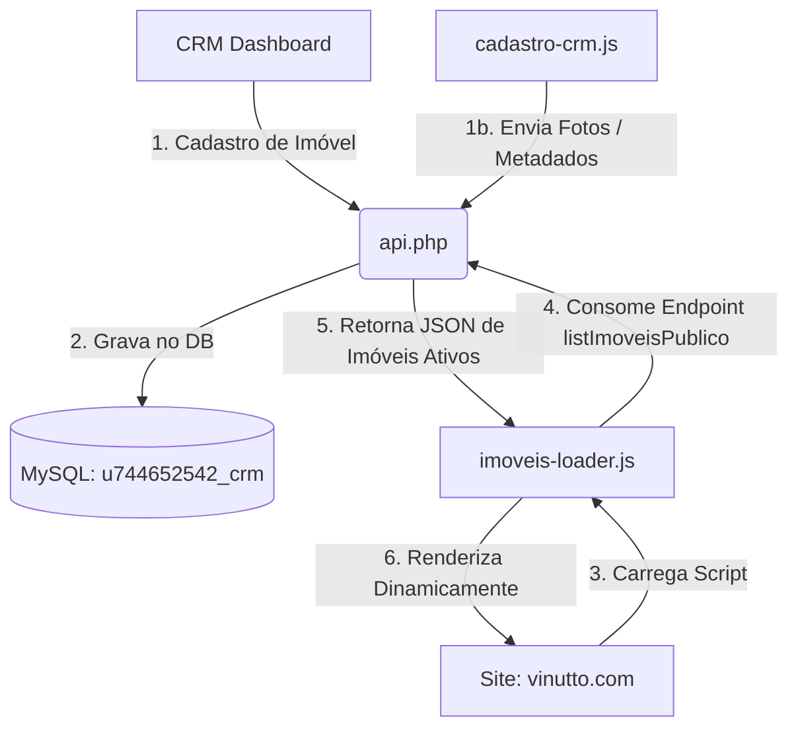

# Guia de Integração: Vinutto.com & CRM em Tempo Real

Este guia explica como funciona a arquitetura de integração e quais passos seguir para que todo imóvel cadastrado no CRM fique online imediatamente no site público **https://vinutto.com**.

---

## 🏗️ 1. Arquitetura da Integração

A integração baseia-se em um **Banco de Dados Único** e centralizado gerenciado pela API PHP do seu CRM.



---

## 🔌 2. Configurações Necessárias

### Passo A: Conexão da API com o Banco de Dados
Certifique-se de que o arquivo [api.php](file:///c:/Users/robso/Dropbox/Vinutto/CRM/api.php) na raiz do servidor de produção (Hostinger) possui as credenciais de banco de dados corretas:
```php
$host = "localhost"; // Normalmente 'localhost' no servidor Hostinger
$db = "u744652542_crm";
$user = "u744652542_u744652542_crm";
$pass = "~*ykfUaZ2kC8";
```

### Passo B: Habilitar CORS
Para que o site externo `https://vinutto.com` consuma a API hospedada em outro local (ou no mesmo domínio), a API já está configurada para aceitar requisições de outras origens:
```php
header('Access-Control-Allow-Origin: *');
header('Access-Control-Allow-Methods: GET, POST, PUT, DELETE, OPTIONS');
header('Access-Control-Allow-Headers: Content-Type, Authorization');
```

---

## 🌐 3. Configurando o Site vinutto.com

Para tornar o site dinâmico e integrado ao CRM, você deve atualizar o código HTML/JS do site público em **vinutto.com**.

### 1. Importação dos Scripts
No arquivo `index.html` (e páginas que listam imóveis) do seu site público, inclua o [imoveis-loader.js](file:///c:/Users/robso/Dropbox/Vinutto/CRM/imoveis-loader.js) **antes** do seu arquivo JS principal (ex: `home.js`), e mantenha o [imoveis-data.js](file:///c:/Users/robso/Dropbox/Vinutto/CRM/imoveis-data.js) apenas como um fallback estático de segurança.

Substitua:
```html
<script src="imoveis-data.js"></script>
<script src="assets/js/home.js"></script>
```

Por:
```html
<!-- Define a URL da API do seu CRM -->
<script>
    window.VINUTTO_API_URL = 'https://seudominio-crm.com/api.php'; // Altere para a URL correta do seu CRM
</script>
<script src="imoveis-loader.js"></script>
<script src="imoveis-data.js"></script>
<script src="assets/js/home.js"></script>
```

### 2. Chamada da API no JavaScript do Site (`home.js`)
No script que renderiza os imóveis no site público, chame a função global de carregamento dinâmico `loadVinuttoImoveis()`.

Exemplo de carregamento:
```javascript
async function iniciarSite() {
    // 1. Carrega os imóveis do CRM. Se falhar, usará automaticamente o fallback do imoveis-data.js
    const catalogo = await window.loadVinuttoImoveis();
    
    console.log("Fonte de dados:", window.IMOVEIS_SOURCE); // 'api' se veio do CRM, 'static' se usou o arquivo JS local
    console.log("Catálogo carregado:", catalogo);
    
    // 2. Chame sua função existente que renderiza os cartões dos imóveis no HTML
    renderizarImoveisNoSite(catalogo.prontos, catalogo.lancamentos);
}

document.addEventListener("DOMContentLoaded", iniciarSite);
```

### 3. Exemplo de Renderização Dinâmica
As variáveis globais preenchidas pelo loader são:
* `window.IMOVEIS`: Contém `{ prontos: [], lancamentos: [] }`
* `window.IMOVEIS_DB`: Objeto com indexação rápida de imóveis pelo ID (`window.IMOVEIS_DB[imovelId]`)

Sua função de renderização pode gerar os cards dinamicamente:
```javascript
function renderizarImoveisNoSite(prontos, lancamentos) {
    const container = document.getElementById("container-imoveis");
    if (!container) return;
    
    container.innerHTML = "";
    
    // Exemplo para imóveis prontos
    prontos.forEach(imovel => {
        // As chaves do objeto (ex: imovel.titulo, imovel.preco) vêm diretamente do banco via API
        container.innerHTML += `
            <div class="card-imovel">
                
                <div class="card-info">
                    <span class="badge ${imovel.badgeClass}">${imovel.badge || 'Lançamento'}</span>
                    <h3>${imovel.titulo}</h3>
                    <p class="bairro">${imovel.bairro}</p>
                    <p class="preco">R$ ${imovel.preco}</p>
                    <a href="imovel.html?slug=${imovel.slug || imovel.id}" class="btn">Ver Detalhes</a>
                </div>
            </div>
        `;
    });
}
```

---

## 🔎 4. Como o Imóvel Fica Online Imediatamente?

No painel de cadastro do CRM:
1. Ao salvar um imóvel, o campo `publicado` é gravado como `1` e o status como `disponivel`.
2. A API do CRM ([api.php](file:///c:/Users/robso/Dropbox/Vinutto/CRM/api.php)) possui o endpoint `listImoveisPublico` (usado pelo loader), que executa a seguinte query SQL:
   ```sql
   SELECT * FROM imoveis 
   WHERE ativo = 1 
     AND COALESCE(publicado, 0) = 1 
     AND status IN ('disponivel', 'reservado')
   ```
3. Toda vez que um usuário acessa `vinutto.com`, o script `imoveis-loader.js` faz uma requisição HTTP `GET` em tempo real para essa API. Como o imóvel recém-cadastrado atende aos critérios acima (ativo, publicado e disponível), ele é retornado no JSON instantaneamente e renderizado na tela do usuário final.
